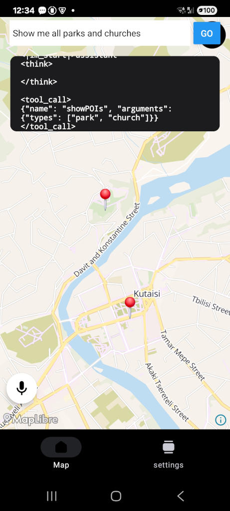
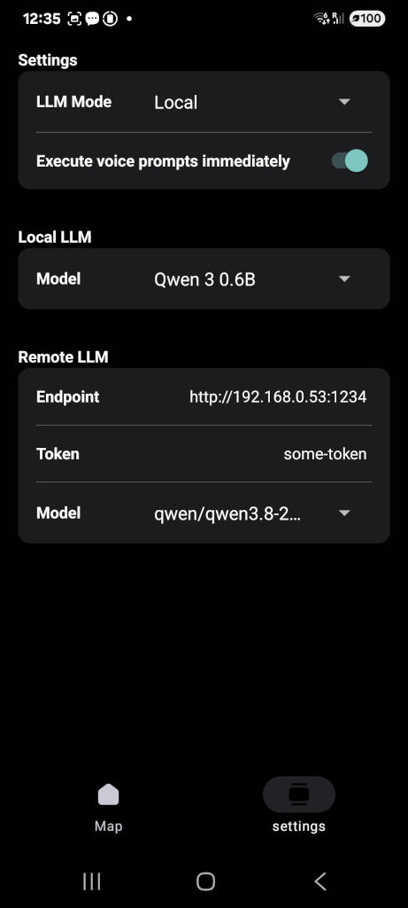

# React Native LLM Tool-Calling Playground

An iOS/Android React Native playground built with [Expo](https://expo.dev) for experimenting with how LLMs call tools, using natural language to drive deterministic APIs and return reliable results.

The app includes an offline map rendered with [MapLibre React Native](https://github.com/maplibre/maplibre-react-native). The LLM controls the map through tool calls such as zooming, resetting the view, and showing points of interest. Because both the map and the model can run on the device, you can test the whole flow with no network connection.

Speak a command and the app transcribes it to text, sends it to the model as a prompt, and automatically executes the resulting tool calls. You can also type commands instead.

  
  &nbsp;&nbsp;
  

## Models

The project supports two ways of running the models:

### On-device (react-native-executorch)

Models run directly on the phone using [react-native-executorch](https://github.com/software-mansion/react-native-executorch), which is built on Meta's [ExecuTorch](https://pytorch.org/executorch/) runtime. Combined with the offline map, this makes the demo fully self-contained: no server, no internet, and no data leaving the device.

### Local server (LM Studio)

[LM Studio](https://lmstudio.ai) runs larger models on your computer, and the app connects to it over your local network. This is the easiest option for trying bigger models than a phone can handle.

### Remote API

The project can be easily reconfigured to use any API-based AI provider.

# Licenses & Attributions

**This demo uses:**

### MapLibre React Native
Map rendering is provided by MapLibre React Native, an open-source mapping library.
MapLibre Project https://maplibre.org/
MIT License https://github.com/maplibre/maplibre-react-native/blob/main/LICENSE.md

### OpenStreetMap
Community-maintained geographic data used as the source of map information.
Map data © OpenStreetMap contributors, available under the Open Database License

OpenStreetMap Copyright & License https://www.openstreetmap.org/copyright
Open Database License (ODbL) https://opendatacommons.org/licenses/odbl/1-0/

### VersaTiles Style
Map styles, icons, and sprites used to define the visual appearance of the maps rendered with MapLibre.

Source Code License https://github.com/versatiles-org/versatiles-style/blob/main/LICENSE.md
Icons License https://github.com/versatiles-org/versatiles-style/blob/main/icons/LICENSE.md
